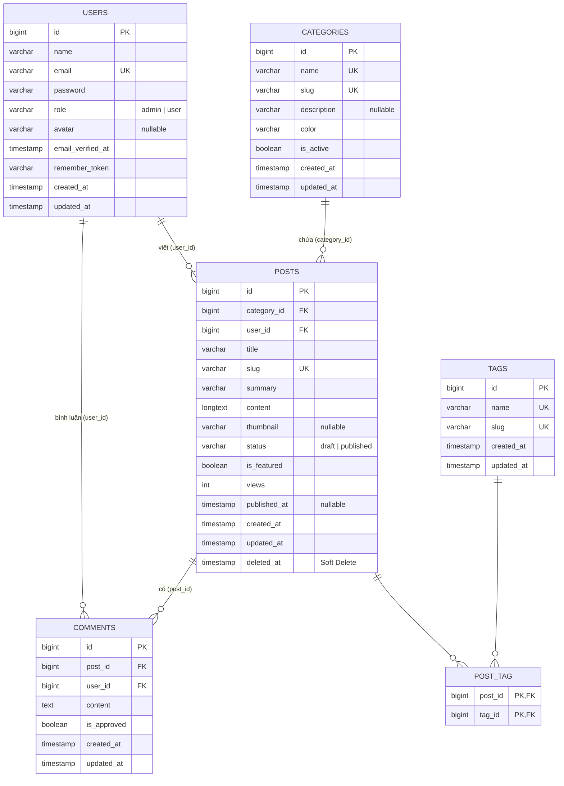
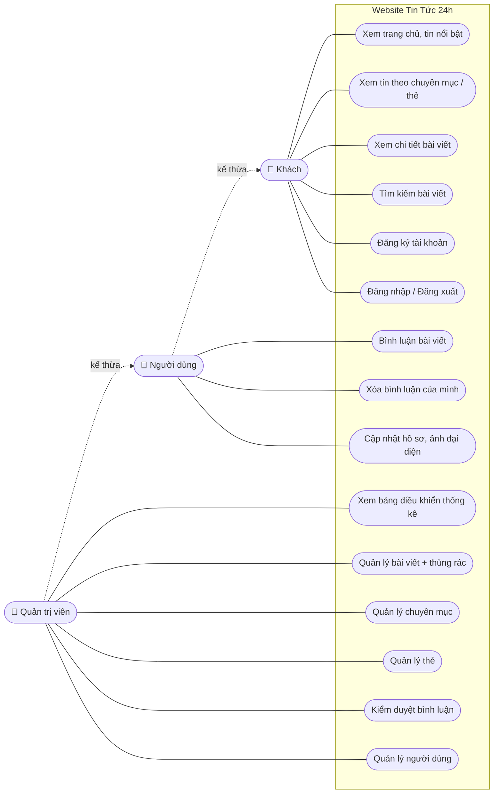

# Phân tích & thiết kế hệ thống — Website Tin Tức 24h

> Các sơ đồ viết bằng Mermaid. GitHub và VS Code (cài extension *Markdown Preview Mermaid Support*) hiển thị trực tiếp. Muốn xuất ảnh PNG để chèn vào báo cáo, dán đoạn mã vào https://mermaid.live rồi bấm *Export PNG*.

## 1. Mô tả đề tài

**Bài toán thực tế.** Một tòa soạn nhỏ (hoặc một nhóm biên tập) cần một trang tin để đăng bài theo chuyên mục. Độc giả phải tìm được tin nhanh và có chỗ để thảo luận. Ban biên tập cần một trang quản trị để soạn bài, sắp xếp chuyên mục và kiểm duyệt bình luận mà không phải can thiệp vào mã nguồn.

**Đối tượng sử dụng**

| Tác nhân | Mô tả |
|---|---|
| Khách | Người truy cập chưa đăng nhập: đọc, lọc và tìm kiếm tin |
| Người dùng (User) | Đã đăng ký tài khoản: có thêm quyền bình luận và quản lý hồ sơ cá nhân |
| Quản trị viên (Admin) | Biên tập viên/quản trị: toàn quyền với khu vực `/admin` |

**Phạm vi chức năng:** quản lý bài viết, chuyên mục, thẻ, bình luận và người dùng; tìm kiếm có phân trang; đăng ký/đăng nhập và phân quyền theo vai trò. Ngoài phạm vi: thanh toán, thông báo qua email, đa ngôn ngữ.

## 2. Sơ đồ ERD

**Ràng buộc khóa ngoại**

| Khóa ngoại | Tham chiếu | Khi xóa bản ghi cha |
|---|---|---|
| posts.category_id | categories.id | RESTRICT — không xóa được chuyên mục còn bài viết |
| posts.user_id | users.id | RESTRICT — không xóa được tác giả còn bài viết |
| comments.post_id | posts.id | CASCADE — xóa bài thì xóa luôn bình luận |
| comments.user_id | users.id | CASCADE |
| post_tag.post_id / tag_id | posts.id / tags.id | CASCADE |

**Quan hệ Eloquent:** `Category hasMany Post`, `Post belongsTo Category / User(author)`, `Post belongsToMany Tag`, `Post hasMany Comment`, `User hasMany Post / Comment`.

Ngoài ra Laravel tạo sẵn các bảng hệ thống: `sessions`, `password_reset_tokens`, `cache`, `jobs`, `migrations`.

## 3. Sơ đồ Use Case

*Người dùng kế thừa mọi chức năng của Khách; Quản trị viên kế thừa mọi chức năng của Người dùng.*

## 4. Mô tả các chức năng chính

| # | Chức năng | Tác nhân | Route | Mô tả & kỹ thuật Laravel |
|---|---|---|---|---|
| 1 | Đăng ký | Khách | `GET/POST /dang-ky` | `RegisterRequest` validate; tạo user `role=user`; tự đăng nhập |
| 2 | Đăng nhập / đăng xuất | Khách / User | `/dang-nhap`, `POST /dang-xuat` | `Auth::attempt`, `throttle:10,1`; admin chuyển thẳng vào `/admin` |
| 3 | Tìm kiếm | Mọi người | `GET /tim-kiem?q=&category=&sort=` | Scope `published()` + `search()`; `paginate(8)->withQueryString()` giữ từ khóa |
| 4 | Gợi ý tìm kiếm | Mọi người | `GET /tim-kiem/goi-y` | AJAX trả JSON 6 bài phù hợp |
| 5 | Xem bài viết | Mọi người | `GET /bai-viet/{slug}` | Route model binding theo slug; tăng `views`; bài nháp trả 404 |
| 6 | Bình luận | User | `POST /bai-viet/{slug}/binh-luan` | `CommentRequest`; trả JSON khi gọi AJAX, flash message khi gửi form thường |
| 7 | Hồ sơ | User | `/tai-khoan` | `ProfileRequest`; upload avatar lên `Storage::disk('public')`; đổi mật khẩu |
| 8 | Quản lý bài viết | Admin | `Route::resource('admin/posts')` | `PostRequest`; upload ảnh; `tags()->sync()`; `SoftDeletes`; restore / forceDelete |
| 9 | Quản lý chuyên mục | Admin | `Route::resource('admin/categories')` | `CategoryRequest`; slug tự sinh; chặn xóa khi còn bài |
| 10 | Quản lý thẻ | Admin | `Route::resource('admin/tags')` | `TagRequest`; quan hệ `belongsToMany` |
| 11 | Kiểm duyệt bình luận | Admin | `/admin/comments` | Lọc, ẩn/hiện (`is_approved`), xóa |
| 12 | Quản lý người dùng | Admin | `Route::resource('admin/users')` | `UserRequest`; phân vai trò; chặn tự xóa / tự hạ quyền |

**Phân quyền:** mọi route `/admin/*` được bọc bởi `middleware(['auth', 'admin'])`. Khách bị chuyển về trang đăng nhập. Người dùng thường nhận lỗi 403 (xem [ảnh](screenshots/user-403.png)).

## 5. Ảnh chụp màn hình

Thư mục [`screenshots/`](screenshots/):

| Ảnh | Nội dung |
|---|---|
| home.png | Trang chủ |
| post.png | Chi tiết bài viết |
| search.png | Tìm kiếm + phân trang |
| category.png | Trang chuyên mục |
| login.png | Đăng nhập |
| user-comment.png | Bình luận AJAX (đã đăng nhập) |
| user-profile.png | Hồ sơ cá nhân |
| user-403.png | User thường vào /admin bị chặn |
| admin-dashboard.png | Dashboard quản trị |
| admin-posts.png | Danh sách bài viết |
| admin-post-validate.png | Form bài viết khi bị lỗi validation |
| admin-trash.png | Thùng rác (Soft Delete) |
| admin-categories.png | Quản lý chuyên mục |
| admin-comments.png | Quản lý bình luận |
| admin-users.png | Quản lý người dùng |

## 6. Hạn chế và hướng phát triển

- Nội dung bài viết lưu dạng HTML do admin soạn. Nếu mở quyền viết bài cho người ngoài cần thêm bước lọc HTML (ví dụ HTMLPurifier).
- Chưa có xác thực email và quên mật khẩu (có thể bổ sung bằng Laravel Notification + Mail).
- Có thể thêm: bình luận trả lời lồng nhau, lưu bài yêu thích, chia sẻ mạng xã hội, API REST cho ứng dụng di động, cache trang chủ.
